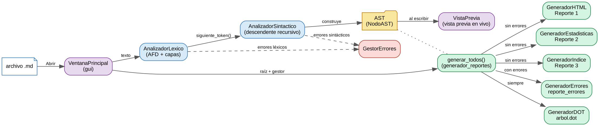
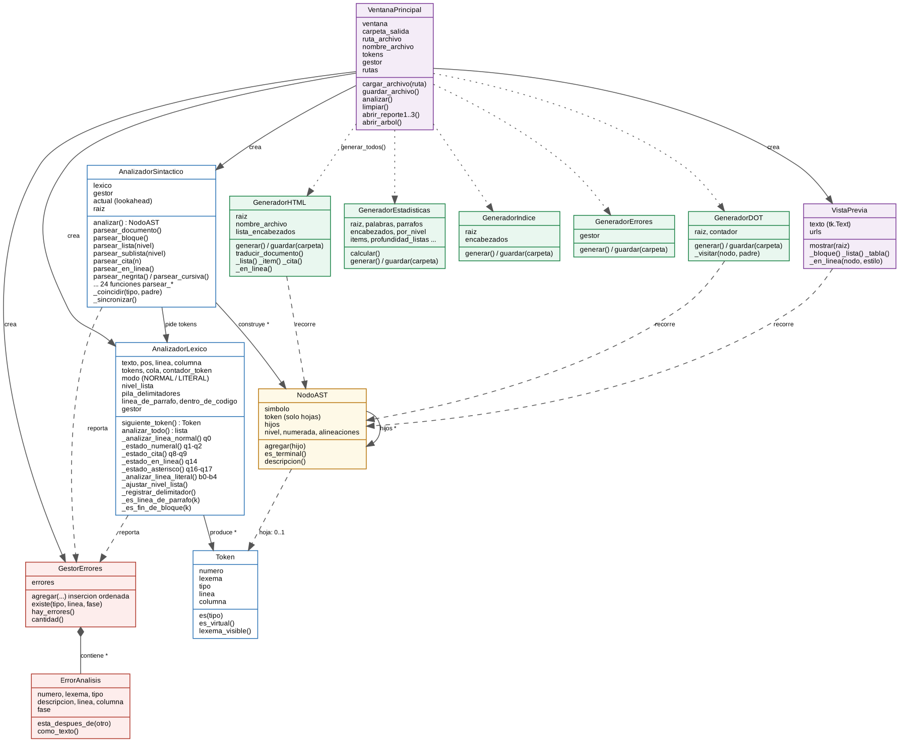
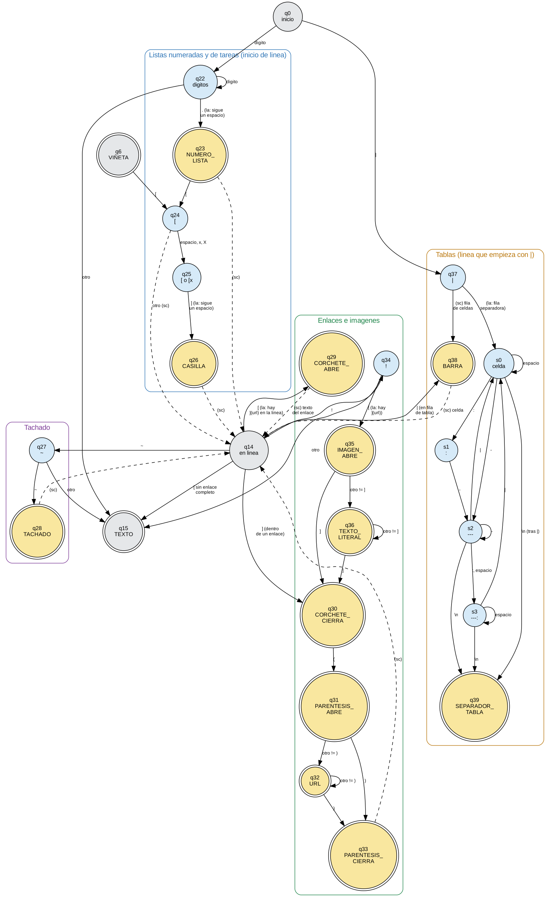
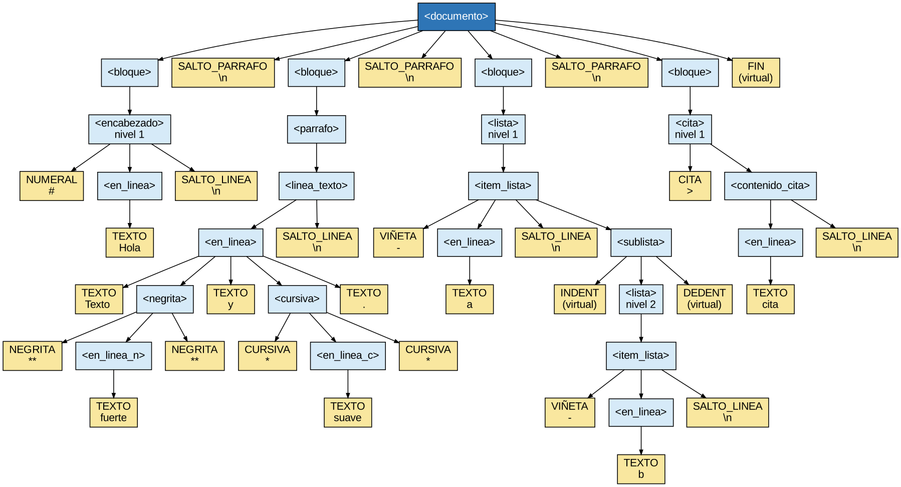

<div class="portada" markdown="1">

# Manual Técnico

**MarkdownCheck** — analizador léxico-sintáctico de Markdown a HTML

Proyecto 2 · Lenguajes Formales y de Programación · Sección B+ · Segundo semestre 2026

Diego Alejandro Barrios · Facultad de Ingeniería, Universidad de San Carlos de Guatemala

</div>

## Contenido

1. Introducción
2. Arquitectura del sistema
3. Diagrama de clases
4. Análisis léxico: tokens y AFD
5. Gramática libre de contexto
6. Parser descendente recursivo
7. Árbol de derivación y Graphviz
8. Errores y estrategia de recuperación
9. Generación de reportes
10. Alcance opcional
11. Pruebas
12. Decisiones de diseño
13. Anexo: árbol de derivación completo del ejemplo del enunciado

<div class="salto"></div>

## 1. Introducción

MarkdownCheck lee un documento escrito en un subconjunto de Markdown, lo
analiza en dos fases (léxica y sintáctica) y lo traduce a HTML **recorriendo
el árbol de derivación** que construye el parser. Además genera estadísticas
del documento, una tabla de contenido, la tabla de tokens, la tabla de
errores y el árbol de derivación en Graphviz.

**Subconjunto reconocido:** encabezados (`#` a `######`), párrafos, negrita
(`**`), cursiva (`*`), código en línea (`` ` ``), listas no ordenadas
(`-`, `*`, `+`) con anidamiento por indentación, citas (`>`) anidadas,
bloques de código delimitados por ```` ``` ```` y regla horizontal (`---`).

**Alcance opcional (completo, sección 10):** listas numeradas (`1.`), listas
de tareas (`- [ ]` / `- [x]`), tachado (`~~`), enlaces (`[texto](url)`),
imágenes (``), tablas con `|`, vista previa en vivo dentro de la
ventana, advertencia de anidamiento con un máximo configurable y resaltado
de sintaxis de los bloques de código en el Reporte 1.

**Tecnologías:** Python 3.10 o superior, Tkinter para la interfaz, Graphviz
para convertir `arbol.dot` en imagen. Se probó con Python 3.10, 3.12 y 3.13.

**Restricciones cumplidas:**

| Restricción del enunciado | Cómo se cumple |
|---|---|
| Sin el módulo `re` para tokenizar | El AFD recorre el texto carácter por carácter con un índice (`self.pos`). Las clases de caracteres son listas explícitas (`alfabeto.py`). |
| Sin librerías de parsing (ply, lark, antlr4…) | El parser es descendente recursivo, escrito a mano: una función por no terminal. |
| Sin librerías de conversión Markdown | El HTML lo produce `GeneradorHTML` recorriendo el AST. |
| HTML a partir del árbol, no por sustitución de texto | Los generadores reciben solo la raíz del árbol; nunca ven el texto original. |

Además, por decisión propia (D-18), el código no usa `if` ternarios,
`lambda`, *slicing*, `sorted()`, `enumerate`, `set()`, decoradores ni
comprensiones, para que cada línea se pueda explicar y modificar en vivo.

## 2. Arquitectura del sistema



El flujo de un análisis es:

1. **`VentanaPrincipal`** toma el texto del editor y crea un `GestorErrores`,
   un `AnalizadorLexico` y un `AnalizadorSintactico`.
2. **`AnalizadorSintactico`** pide tokens con `siguiente_token()` a medida que
   los necesita y construye el árbol (`NodoAST`).
3. **`AnalizadorLexico`** analiza una línea completa cada vez que se le acaban
   los tokens: el AFD reconoce los tokens de la línea y tres capas
   posteriores agregan `INDENT`/`DEDENT`, validan los delimitadores y los
   ponen en una cola.
4. Ambos analizadores registran sus errores en el **`GestorErrores`**, que los
   mantiene ordenados por posición. Ninguno se detiene ante un error.
5. **`generar_todos()`** decide qué reportes escribir según haya o no errores.

### Estructura de carpetas

```
Proyecto2/
├── src/
│   ├── main.py                     punto de entrada
│   ├── lexico/                     alfabeto.py, token.py, analizador_lexico.py
│   ├── sintactico/                 nodo_ast.py, analizador_sintactico.py
│   ├── errores/                    error_analisis.py, gestor_errores.py
│   ├── reportes/                   plantilla.py, recorridos.py, generador_*.py
│   │   └── recursos/               highlight.js y su tema (resaltado, D-36)
│   └── gui/                        ventana_principal.py, vista_previa.py
├── tests/                          pruebas de consola (una suite por fase)
├── examples/                       archivos .md de entrada y casos/
└── docs/                           diseño, manuales y casos de prueba
```

Las dependencias van en un solo sentido: `lexico` no conoce a nadie más que a
`errores`; `sintactico` conoce a `lexico`; `reportes` solo conoce el árbol;
`gui` junta todo. Así se puede probar cada fase por separado desde consola.

<div class="salto"></div>

## 3. Diagrama de clases



| Clase | Responsabilidad | Lo que no hace |
|---|---|---|
| `Token` | Guarda número, lexema, tipo, línea y columna de un token. | — |
| `AnalizadorLexico` | AFD manual, `INDENT`/`DEDENT`, pila de delimitadores, cola de tokens. Expone `siguiente_token()`. | No conoce el árbol ni el HTML. |
| `NodoAST` | Un nodo del árbol: símbolo, token (solo hojas), hijos y atributos (`nivel`; `numerada` en listas; `alineaciones` en tablas). | — |
| `AnalizadorSintactico` | Una función por no terminal; construye el árbol y se recupera de errores. | No lee caracteres. |
| `ErrorAnalisis` | Un registro de la tabla de errores. | — |
| `GestorErrores` | Acumula los errores de las dos fases, ordenados por posición. | — |
| `GeneradorHTML` | Reporte 1: traduce el árbol a HTML. | No mira el texto original. |
| `GeneradorEstadisticas` | Reporte 2: cuenta nodos del árbol. | — |
| `GeneradorIndice` | Reporte 3: tabla de contenido con anclas al Reporte 1. | — |
| `GeneradorErrores` | Tabla de errores en HTML. | — |
| `GeneradorDOT` | `arbol.dot` con el árbol de derivación real. | — |
| `VentanaPrincipal` | Interfaz Tkinter: editor, tablas, árbol, vista previa, botones de reportes y aviso de anidamiento. | No analiza nada por sí misma. |
| `VistaPrevia` | Dibuja el documento formateado en un `tk.Text` recorriendo el árbol. | No mira el texto original. |

<div class="salto"></div>

## 4. Análisis léxico: tokens y AFD

### 4.1 Tokens de la sección 4.5 del enunciado

<!--INCLUIR 2.1-->

### 4.2 Tokens agregados

<!--INCLUIR 2.2-->

### 4.3 Reglas de prioridad

<!--INCLUIR 2.3-->

### 4.4 Diagrama del AFD

Doble círculo = estado de aceptación. "(sc)" significa que la transición se
hace **sin consumir** el carácter (lookahead): el AFD nunca retrocede el
índice. El autómata tiene dos modos: normal y literal (dentro de un bloque de
código).


### 4.5 Estados

<!--INCLUIR 3.1-->

### 4.6 Transiciones del modo normal

<!--INCLUIR 3.2-->

### 4.7 Transiciones del modo literal

<!--INCLUIR 3.3-->

### 4.8 Capas posteriores al autómata

<!--INCLUIR 3.4-->

### 4.9 Mapa estado → método

Cada estado del diagrama corresponde a un método de `AnalizadorLexico`:

| Estados | Método |
|---|---|
| q0, q21 | `_analizar_linea_normal()` |
| q6, q7 | `_estado_vineta()` |
| q1, q2 | `_estado_numeral()` |
| q3, q4, q5 | `_es_regla_horizontal()`, `_estado_regla()` |
| q8, q9 | `_estado_cita()` |
| q10 a q13 | `_estado_cerca_apertura()` |
| q14 | `_estado_en_linea()` |
| q15 | `_estado_texto()` |
| q16, q17 | `_estado_asterisco()` |
| q18, q19 | `_estado_codigo_inline()` |
| q20 | `_estado_fin_linea()` |
| b0 a b4 | `_analizar_linea_literal()` |

Además, `_es_linea_de_parrafo()` y `_es_fin_de_bloque()` hacen el
*lookahead* que decide si un párrafo sigue en la línea siguiente (D-02): la
primera repite las decisiones de `q0` sin consumir, y la segunda la usan la
pila de delimitadores, el código en línea y el caso `***` para saber hasta
dónde llega el bloque.

### 4.10 Tokens del alcance opcional

<!--INCLUIR 2.4-->

### 4.11 AFD del alcance opcional

Estos estados se suman al AFD de la sección 4.4: `q0`, `q6`, `q14` y `q15`
(en gris) son los mismos estados de ese diagrama. "(la)" marca las
decisiones que se toman con lookahead.

<div class="salto"></div>



<!--INCLUIR 3.5-->

| Estados | Método |
|---|---|
| q22, q23 | `_es_numero_de_lista()`, `_estado_numero_lista()` |
| q24 a q26 | `_estado_casilla()` |
| q27, q28 | `_estado_tachado()` |
| q29 a q33 | `_estado_enlace()`, `_cierre_de_corchete()`, `_estado_cierre_enlace()`, `_estado_destino()` |
| q34 a q36 | `_estado_imagen()` |
| q37, q38 | `_estado_tabla()`, `_estado_barra()` |
| s0 a s3, q39 | `_es_separador_tabla()` |

<div class="salto"></div>

## 5. Gramática libre de contexto

### 5.1 Gramática formal (BNF)

<!--INCLUIR 4.1-->

### 5.2 Conjuntos FIRST y propiedad LL(1)

<!--INCLUIR 4.2-->

### 5.3 Forma EBNF que implementa el parser

<!--INCLUIR 4.3-->

<div class="salto"></div>

## 6. Parser descendente recursivo

### 6.1 Algoritmo

El parser mantiene **un solo token de lookahead**, `self.actual`. Cada no
terminal de la forma EBNF (sección 5.3) es una función `parsear_*` que:

1. crea el nodo de su no terminal (`no_terminal('<lista>')`);
2. consume los terminales que exige la producción con
   `_coincidir(tipo, nodo)`, que los agrega como hojas;
3. llama a la función de cada no terminal que contiene y agrega como hijo el
   nodo que esa función devuelve;
4. devuelve su nodo.

Las repeticiones `{ … }` son ciclos `while` controlados por el conjunto FIRST
de lo que se repite; las partes opcionales `[ … ]` son `if`. Las alternativas
se eligen mirando `self.actual`, porque sus FIRST son disjuntos.

| No terminal | Función | Decisión que toma |
|---|---|---|
| `<documento>` | `parsear_documento()` | Repite `<elemento_doc>` hasta `FIN`. |
| `<elemento_doc>` | `parsear_elemento_doc(padre)` | `SALTO_PARRAFO`, un bloque o recuperación. |
| `<bloque>` | `parsear_bloque()` | Por el token actual: `NUMERAL`, `VIÑETA` o `NUMERO_LISTA`, `CITA`, `CERCA_CODIGO`, `REGLA_HORIZONTAL`, `BARRA` o `SEPARADOR_TABLA`, o texto. |
| `<encabezado>` | `parsear_encabezado()` | `nivel` = cantidad de `#`. |
| `<parrafo>` | `parsear_parrafo()` | Sigue mientras la línea siguiente pueda empezar un párrafo. |
| `<linea_texto>` | `parsear_linea_texto()` | — |
| `<lista(t)>` | `parsear_lista(nivel)` | `t` = marcador del primer ítem; sigue mientras venga el mismo marcador. |
| `<item_lista(t)>` | `parsear_item_lista(nivel, marcador)` | `CASILLA` opcional; si viene `INDENT`, hay sublista. |
| `<sublista>` | `parsear_sublista(nivel)` | Llama a `parsear_lista(nivel + 1)` mientras venga un marcador; recuperación de `INDENT` doble. |
| `<cita(n)>` | `parsear_cita(n)` | Sigue mientras venga una `CITA` de nivel ≥ n. |
| `<elemento_cita(n)>` | `parsear_elemento_cita(padre, n)` | Nivel > n: `parsear_cita(n + 1)`; si no, línea de esta cita. |
| `<contenido_cita>` | `parsear_contenido_cita()` | `NUMERAL`: encabezado; si no, texto. |
| `<bloque_codigo>` | `parsear_bloque_codigo()` | Lenguaje opcional. |
| `<contenido_codigo>` | `parsear_contenido_codigo()` | Sigue mientras venga `TEXTO_LITERAL`. |
| `<regla_horizontal>` | `parsear_regla_horizontal()` | — |
| `<tabla>` | `parsear_tabla()` | Encabezado, `SEPARADOR_TABLA` y filas mientras venga `BARRA`; `TABLA_MAL_FORMADA`. |
| `<fila_tabla>` | `parsear_fila_tabla()` | Celda y `BARRA` mientras haya algo que empiece una celda. |
| `<celda>` | `parsear_celda()` | — |
| `<en_linea>` | `parsear_en_linea()` | Sigue mientras venga un elemento en línea. |
| `<elemento_linea>` | `parsear_elemento_linea(padre)` | Negrita, cursiva, tachado, código, enlace, imagen o texto. |
| `<negrita>` | `parsear_negrita()` | — |
| `<en_linea_n>` | `parsear_en_linea_n()` | El siguiente `NEGRITA` siempre cierra. |
| `<elemento_n>` | `parsear_elemento_n(padre)` | Cursiva, tachado, código, enlace, imagen, texto o `SALTO_LINEA` (negrita en varias líneas). |
| `<cursiva>` | `parsear_cursiva()` | — |
| `<en_linea_c>` | `parsear_en_linea_c()` | El siguiente `CURSIVA` siempre cierra. |
| `<elemento_c>` | `parsear_elemento_c(padre)` | Negrita, tachado, código, enlace, imagen, texto o `SALTO_LINEA` (cursiva en varias líneas). |
| `<tachado>` | `parsear_tachado()` | — |
| `<en_linea_t>` | `parsear_en_linea_t()` | El siguiente `TACHADO` siempre cierra. |
| `<elemento_t>` | `parsear_elemento_t(padre)` | Negrita, cursiva, código, enlace, imagen, texto o `SALTO_LINEA`. |
| `<codigo_inline>` | `parsear_codigo_inline()` | Repite `TEXTO_LITERAL` o `SALTO_LINEA` hasta el `CODIGO_INLINE` de cierre. |
| `<enlace>` | `parsear_enlace()` | El texto es un `<en_linea>` que termina en `CORCHETE_CIERRA`. |
| `<imagen>` | `parsear_imagen()` | Texto alternativo opcional. |
| `<destino>` | `parsear_destino()` | URL opcional. |

### 6.2 Dónde está la recursión

- **Recursión mutua en línea.** `parsear_negrita()` llama a
  `parsear_en_linea_n()`, que puede llamar a `parsear_cursiva()`, que llama a
  `parsear_en_linea_c()`, que puede llamar otra vez a `parsear_negrita()`.
  Por eso `*a **b *c* d** e*` se reconoce con tres niveles alternados. El
  tachado entra en el mismo ciclo, y un enlace vuelve a llamar a
  `parsear_en_linea()` para su texto.
- **Listas.** `parsear_lista(n)` → `parsear_item_lista(n)` →
  `parsear_sublista(n)` → `parsear_lista(n + 1)`. Cada nivel de sangría es
  una llamada más profunda; el `DEDENT` hace que la llamada interna termine y
  el control vuelva al nivel de afuera.
- **Citas.** `parsear_cita(n)` → `parsear_elemento_cita(padre, n)` →
  `parsear_cita(n + 1)`. Es la recursión directa de `<cita>` que menciona el
  enunciado, guiada por el atributo `n`.

### 6.3 Traza de ejemplo

Entrada: `- a` / `  - b` / `- c`. Tokens:
`VIÑETA TEXTO SALTO_LINEA INDENT VIÑETA TEXTO SALTO_LINEA DEDENT VIÑETA TEXTO SALTO_LINEA FIN`.

```
parsear_documento()                         actual = VIÑETA
  parsear_bloque()                          VIÑETA -> lista
    parsear_lista(1)
      parsear_item_lista(1)                 consume VIÑETA, <en_linea>(a), SALTO_LINEA
        actual = INDENT -> hay sublista
        parsear_sublista(1)                 consume INDENT
          parsear_lista(2)
            parsear_item_lista(2)           consume VIÑETA, <en_linea>(b), SALTO_LINEA
            actual = DEDENT: no es VIÑETA -> termina la lista de nivel 2
          consume DEDENT
      actual = VIÑETA -> otro item en la lista de nivel 1
      parsear_item_lista(1)                 consume VIÑETA, <en_linea>(c), SALTO_LINEA
      actual = FIN -> termina la lista de nivel 1
  consume FIN
```

### 6.4 Construcción del árbol

<!--INCLUIR D-17-->

Las pruebas verifican una propiedad que define a un árbol de derivación: sus
hojas, leídas de izquierda a derecha, son **exactamente todos los tokens** de
la entrada y en el mismo orden. Se cumple para el ejemplo del enunciado, para
los archivos con errores (la recuperación no pierde tokens) y para 400
documentos generados al azar.

<div class="salto"></div>

## 7. Árbol de derivación y Graphviz

`GeneradorDOT` recorre el árbol en preorden. Cada nodo recibe un
identificador (`n0`, `n1`, …) y una arista desde su padre. Colores
(sección 4.10 del enunciado): la raíz `<documento>` en azul oscuro, los no
terminales en azul claro y los terminales (tokens) en amarillo, con su tipo y
su lexema. Los atributos `nivel` de listas, citas y encabezados aparecen en
la etiqueta.

Árbol del caso pequeño `# Hola` / `Texto **fuerte** y *suave*.` /
`- a` / `  - b` / `> cita`:



El árbol completo del ejemplo de la sección 4.7 del enunciado está en el
anexo (sección 13). El archivo `arbol.dot` se genera **siempre**, también
cuando hay errores, porque muestra hasta dónde llegó el parser.

<div class="salto"></div>

## 8. Errores y estrategia de recuperación

<!--INCLUIR 5-->

### 8.1 Modo pánico

- **Léxico.** Ningún error detiene el AFD. Un delimitador sin pareja se
  convierte en `TEXTO` al terminar su bloque, un `#` de más deja la línea como
  texto, una sangría impar toma el nivel inferior y un bloque de código sin
  cerrar llega hasta el fin del archivo.
- **Sintáctico.** `_coincidir()` reporta `TOKEN_INESPERADO` y llama a
  `_sincronizar()`, que descarta tokens hasta un punto seguro (`SALTO_LINEA`,
  `SALTO_PARRAFO` o `FIN`). Si ese punto es justo el token esperado, se
  consume y el análisis sigue como si nada.
- **Indentación.** Cada `INDENT` sobrante se analiza como otra `<sublista>`,
  así cada uno encuentra su `DEDENT` y el resto del archivo no se desbalancea.
- **Sin duplicados.** Mientras el parser se recupera no repite un error del
  mismo tipo, línea y fase (D-22).
- **Orden.** `GestorErrores.agregar()` inserta cada error en su lugar según
  línea y columna (ordenamiento por inserción), porque los errores no se
  detectan en el orden del archivo: una negrita sin cerrar solo se conoce al
  terminar su párrafo.

Cada recorrido del parser consume al menos un token por vuelta, así que el
análisis siempre termina. Se comprobó con 300 secuencias de tokens al azar
entregadas por un léxico falso y con 20 000 documentos al azar durante el
desarrollo.

## 9. Generación de reportes

| Reporte | Archivo | Cómo se obtiene del árbol |
|---|---|---|
| 1. Documento | `reporte1_documento.html` | `GeneradorHTML`: una función por no terminal; la recursión del recorrido reproduce el anidamiento. |
| 2. Estadísticas | `reporte2_estadisticas.html` | `GeneradorEstadisticas`: cada número es la cantidad de nodos de un no terminal o el `nivel` máximo. |
| 3. Índice | `reporte3_indice.html` | `GeneradorIndice`: solo los nodos `<encabezado>`, con anclas `seccion-k`. |
| Errores | `reporte_errores.html` | `GeneradorErrores`: la tabla del `GestorErrores`. |
| Árbol | `arbol.dot` (y `arbol.png` si hay Graphviz) | `GeneradorDOT`. |

Traducción del Reporte 1:

| Nodo | HTML |
|---|---|
| `<encabezado>` nivel n | `<hn id="seccion-k">` |
| `<parrafo>` | `<p>` (sus líneas en un mismo párrafo) |
| `<lista>` / `<item_lista>` | `<ul>` / `<li>`, con la sublista dentro del `<li>` del ítem padre |
| `<cita>` | `<blockquote>`, anidado a la misma profundidad |
| `<bloque_codigo>` | `<pre><code class="language-x">` con el contenido literal |
| `<regla_horizontal>` | `<hr>` |
| `<negrita>`, `<cursiva>`, `<codigo_inline>` | `<strong>`, `<em>`, `<code>` |
| `<lista>` numerada | `<ol>`, con `start` si el primer número no es 1 |
| `CASILLA` | `<li class="tarea"><input type="checkbox" disabled>`, con `checked` si es `[x]` |
| `<tachado>` | `<del>` |
| `<enlace>` | `<a href="url">` con el texto del enlace traducido adentro |
| `<imagen>` | `` |
| `<tabla>` | `<table>` con `<thead>`/`<th>` para el encabezado y `<tbody>`/`<td>`; cada celda con la alineación de su columna |

Todo texto se escapa (`&`, `<`, `>`, `"`), así que un `<script>` escrito en
el `.md` se muestra como texto. Los tres reportes llevan su CSS embebido y se
abren en cualquier navegador sin archivos adicionales. Si el documento tiene
un bloque de código con lenguaje, el Reporte 1 también lleva embebido
highlight.js para colorearlo (D-36); sigue siendo un solo archivo y no
necesita internet.

## 10. Alcance opcional

Los siete puntos del alcance opcional (sección 4.2 del enunciado) están
implementados. Cada uno sigue el mismo camino que lo obligatorio: tokens del
AFD, una producción con su función `parsear_*`, un nodo del árbol y su
traducción recorriendo el árbol.

| Punto | Léxico | Sintáctico | Salida | Decisión |
|---|---|---|---|---|
| Listas ordenadas | `NUMERO_LISTA` (`q22`, `q23`) | `<lista(t)>` con el atributo `t` | `<ol start>` | D-29 |
| Listas de tareas | `CASILLA` (`q24`..`q26`) | `[ CASILLA ]` en `<item_lista>` | casilla marcada o vacía | D-30 |
| Tachado | `TACHADO` (`q27`, `q28`), en la pila | `<tachado>`, `<en_linea_t>` | `<del>` | D-31 |
| Enlaces e imágenes | `CORCHETE_ABRE`, `IMAGEN_ABRE`, `CORCHETE_CIERRA`, `PARENTESIS_*`, `URL` | `<enlace>`, `<imagen>`, `<destino>` | `<a>`, `` | D-32 |
| Tablas | `BARRA`, `SEPARADOR_TABLA` (`s0`..`s3`) | `<tabla>`, `<fila_tabla>`, `<celda>` | `<table>` alineada | D-33 |
| Vista previa en vivo | — | árbol del texto del editor | `VistaPrevia` (Tkinter) | D-34 |
| Advertencia de anidamiento | — | atributo `nivel` de `<lista>` y `<cita>` | franja amarilla y líneas marcadas | D-35 |
| Resaltado de sintaxis | — (el bloque sigue siendo literal) | — | highlight.js en el Reporte 1 | D-36 |

**Errores nuevos.** `TACHADO_SIN_CERRAR` (léxico) sigue la misma regla que la
negrita: se reporta en su apertura cuando termina el bloque.
`TABLA_MAL_FORMADA` (sintáctico) se reporta cuando falta el encabezado o la
fila separadora, cuando la separadora se repite, o cuando una fila no
termina en `|` o no tiene tantas celdas como el encabezado. Un corchete que
no forma un enlace completo es texto, no un error.

**Ámbitos de la pila.** El texto de un enlace y cada celda de una tabla son
ámbitos propios de la pila de delimitadores: al abrir un enlace se mete el
`CORCHETE_ABRE` como marca, y al llegar a su `]` (o a la `BARRA` de la
celda) se reporta lo que quedó abierto. Así el parser nunca recibe una
negrita que cruce el `]` de un enlace o la `|` de una celda.

**Vista previa en vivo.** `VistaPrevia` es otro destino de la misma
traducción dirigida por la sintaxis: recorre el árbol con una función por no
terminal, igual que `GeneradorHTML`, pero escribe en un `tk.Text` con
etiquetas de formato. `Estilo` acumula el formato al bajar por el árbol
(dentro de una negrita todo es negrita), porque Tkinter solo admite una
fuente por fragmento. Se actualiza 400 ms después de la última tecla
(`after()` / `after_cancel()`), con su propio `GestorErrores`.

**Advertencia de anidamiento.** `recorridos.excesos_de_anidamiento(raiz,
maximo)` devuelve cada `<lista>` y `<cita>` cuyo `nivel` pasa del máximo,
con las líneas que ocupa. La ventana muestra el nivel más profundo de cada
una en una franja amarilla y marca esas líneas en el editor. El máximo se
cambia en la barra inferior y la advertencia se recalcula al momento.

## 11. Pruebas

| Suite | Qué prueba | Verificaciones |
|---|---|---|
| `tests/prueba_lexico.py` | Tokens, posiciones, prioridades, errores léxicos, `INDENT`/`DEDENT`, modo literal, archivos de Windows, línea y columna exactas de cada token en los 19 ejemplos, delimitadores que cruzan líneas de un párrafo, tokens del alcance opcional | 109 |
| `tests/prueba_sintactico.py` | Árbol del ejemplo, recursión en línea, listas y citas anidadas, errores sintácticos, documentos y tokens al azar, negrita y código en varias líneas, listas numeradas, tachado, enlaces, tablas y `TABLA_MAL_FORMADA` | 101 |
| `tests/prueba_reportes.py` | HTML exacto del Reporte 1, escape, `arbol.dot`, valores del Reporte 2, índice, selección de reportes, limpieza de reportes viejos, saltos dentro de negrita y código, HTML y estadísticas del alcance opcional, resaltado de sintaxis | 76 |
| `tests/prueba_interfaz.py` | La ventana: carga (solo `.md`), análisis, tablas, botones, saltos al editor, vista previa en vivo y advertencia de anidamiento | 37 |
| `tests/prueba_casos.py` | Los 15 casos documentados en *Casos de Prueba* | 82 |

Durante el desarrollo del alcance opcional se comprobó además, con
documentos generados al azar: 50 000 documentos con su sintaxis sin
excepciones, sin `TOKEN_INESPERADO`, con la frontera completa, cada lexema en
su línea y columna y el HTML bien cerrado; 4000 documentos válidos con 0
errores y estadísticas iguales a las esperadas; y 20 000 secuencias de tokens
al azar en las que el modo pánico siempre llegó a `FIN`.

## 12. Decisiones de diseño

<!--INCLUIR 6-->

<div class="salto"></div>

## 13. Anexo: árbol de derivación completo del ejemplo del enunciado

Árbol generado por `GeneradorDOT` para `examples/ejemplo_valido.md`
(sección 4.7 del enunciado): 77 hojas, una por token.

Como es muy ancho, se muestra en cuatro franjas que se leen de izquierda a
derecha; cada franja repite un borde de la anterior para no perder el hilo.

<!--ANEXO-->
