<div class="portada" markdown="1">

# Manual de Usuario

**MarkdownCheck** — analizador léxico-sintáctico de Markdown a HTML

Proyecto 2 · Lenguajes Formales y de Programación · Sección B+ · Segundo semestre 2026

Diego Alejandro Barrios · Facultad de Ingeniería, Universidad de San Carlos de Guatemala

</div>

## Contenido

1. ¿Qué es MarkdownCheck?
2. Requisitos
3. Cómo ejecutar la aplicación
4. Partes de la ventana
5. Sintaxis Markdown soportada
6. Cargar y analizar un archivo
7. La tabla de tokens
8. El árbol de derivación
9. Errores: cómo leerlos y corregirlos
10. Los reportes HTML
11. Vista previa en vivo y advertencia de anidamiento
12. Solución de problemas

<div class="salto"></div>

## 1. ¿Qué es MarkdownCheck?

MarkdownCheck lee un documento escrito en Markdown (un archivo `.md`),
revisa que esté bien escrito y lo convierte en una página HTML que se puede
abrir en cualquier navegador.

El análisis tiene dos etapas:

1. **Análisis léxico.** El programa separa el texto en piezas llamadas
   *tokens*: un `#` de encabezado, un `**` de negrita, un texto, un salto de
   línea…
2. **Análisis sintáctico.** Revisa que esas piezas estén en un orden válido
   (por ejemplo, que una negrita que se abre también se cierre) y arma con
   ellas el *árbol de derivación* del documento.

Si el documento no tiene errores, el programa genera tres reportes: el
documento convertido a HTML, sus estadísticas y una tabla de contenido. Si
tiene errores, los muestra todos juntos, con la línea y la columna de cada
uno, para que se puedan corregir de una sola vez.

Además de lo básico, MarkdownCheck reconoce listas numeradas, listas de
tareas, texto tachado, enlaces, imágenes y tablas; muestra el documento
formateado **mientras se escribe**, avisa cuando una lista o una cita está
demasiado anidada y colorea el código en el Reporte 1.

## 2. Requisitos

| Programa | ¿Obligatorio? | Para qué se usa |
|---|---|---|
| Python 3.10 o superior | Sí | Ejecutar la aplicación. Tkinter, la librería de la ventana, viene incluida con Python en Windows. |
| Un navegador web | Sí | Abrir los reportes HTML. Sirve cualquiera: Chrome, Edge, Firefox. |
| Graphviz | No | Convertir el árbol de derivación (`arbol.dot`) en una imagen. Sin Graphviz, todo lo demás funciona igual. |

**Verificar Python.** En una terminal (PowerShell o Símbolo del sistema):

```
python --version
```

Debe mostrar `Python 3.10` o un número mayor. Si dice que el comando no
existe, instale Python desde python.org y marque la casilla
**Add Python to PATH** durante la instalación.

**Instalar Graphviz (opcional).** En Windows:

```
winget install graphviz
```

o descárguelo desde graphviz.org. Después de instalarlo, cierre y vuelva a
abrir la terminal, y verifique con `dot -V`.

## 3. Cómo ejecutar la aplicación

Abra una terminal en la carpeta `Proyecto2` y ejecute:

```
python src/main.py
```

Para abrir la ventana con un archivo ya cargado, escriba la ruta después:

```
python src/main.py examples/ejemplo_valido.md
```

**Desde Visual Studio Code.** Abra la carpeta `Proyecto2`, vaya a la vista
**Ejecutar y depurar** (Ctrl+Shift+D), elija **MarkdownCheck (ventana)** o
**MarkdownCheck (ejemplo valido)** y presione F5.

Al iniciar se abre la ventana vacía:

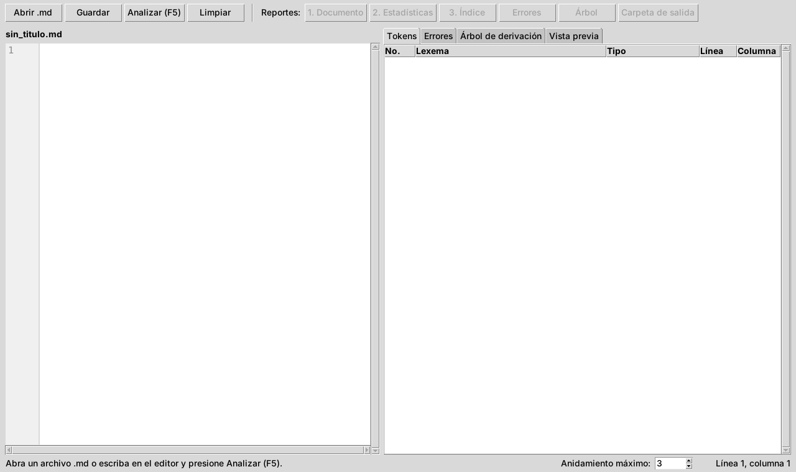

La carpeta `examples` trae archivos listos para probar:

| Archivo | Qué contiene |
|---|---|
| `ejemplo_valido.md` | El ejemplo del enunciado: todos los elementos, sin errores. |
| `casos_borde.md` | Casos especiales que el programa debe aceptar. |
| `errores_lexicos.md` | Un error léxico de cada tipo. |
| `errores_sintacticos.md` | Errores de indentación y de citas. |
| `casos/` | Los 15 casos del documento *Casos de Prueba*. El caso 14 usa todo el alcance opcional (listas numeradas, tareas, tachado, enlaces, imágenes y tablas). |

<div class="salto"></div>

## 4. Partes de la ventana

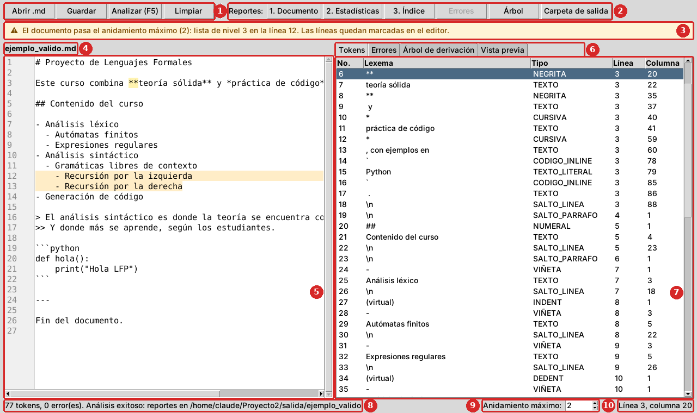

Cada número de la imagen corresponde a una fila de la tabla siguiente.

<div class="salto"></div>

| No. | Parte | Para qué sirve |
|---|---|---|
| 1 | Botones de archivo | **Abrir .md** carga un archivo (Ctrl+O). **Guardar** guarda lo que hay en el editor (Ctrl+S). **Analizar** revisa el documento (F5). **Limpiar** vacía el editor y los resultados. |
| 2 | Botones de reportes | Abren en el navegador los reportes del último análisis. Solo se activan los que existen: sin errores, los reportes 1, 2 y 3; con errores, el de errores. **Árbol** y **Carpeta de salida** están siempre disponibles después de analizar. |
| 3 | Advertencia de anidamiento | Solo aparece cuando una lista o una cita pasa el anidamiento máximo (sección 11). En la imagen el máximo es 2 y la lista llega al nivel 3. |
| 4 | Nombre del archivo | El archivo que está abierto en el editor. |
| 5 | Editor | El texto del documento, con números de línea. Se puede escribir y corregir aquí mismo. Las líneas demasiado anidadas se marcan en amarillo. |
| 6 | Pestañas de resultados | **Tokens**, **Errores**, **Árbol de derivación** y **Vista previa**. La pestaña Errores muestra entre paréntesis cuántos hay. |
| 7 | Resultado | El contenido de la pestaña elegida. |
| 8 | Barra de estado | El resumen del último análisis: cuántos tokens y errores encontró, y dónde guardó los reportes. |
| 9 | Anidamiento máximo | Cuántos niveles de lista o de cita se permiten antes de mostrar la advertencia (de 1 a 20; empieza en 3). |
| 10 | Posición del cursor | La línea y la columna donde está el cursor en el editor. Sirve para ubicar la posición que indica un error. |

<div class="salto"></div>

## 5. Sintaxis Markdown soportada

| Elemento | Cómo se escribe | Resultado |
|---|---|---|
| Encabezado | De 1 a 6 `#`, un espacio y el título: `## Título` | Un título de nivel 1 a 6. |
| Párrafo | Una o más líneas de texto seguidas. | Un párrafo. |
| Negrita | `**texto**` | **texto** |
| Cursiva | `*texto*` | *texto* |
| Negrita y cursiva | `***texto***`, o una dentro de la otra: `**muy *importante***` | Las dos combinadas. |
| Código en línea | `` `variable` `` | `variable`, sin interpretar lo que hay adentro. |
| Lista | `-`, `*` o `+`, un espacio y el texto: `- Elemento` | Una lista con viñetas. |
| Sublista | Dos espacios más de sangría por cada nivel: `  - Subelemento` | Una lista dentro de otra, sin límite de niveles. |
| Cita | `>`, un espacio y el texto: `> Cita` | Un bloque de cita. |
| Cita anidada | `>>` o `> >` y el texto: `>> Cita interna` | Una cita dentro de otra. |
| Bloque de código | Una línea con ```` ``` ```` (opcionalmente con el lenguaje: ```` ```python ````), el código, y otra línea con ```` ``` ```` | El código tal como está escrito. |
| Regla horizontal | Tres o más guiones solos en una línea: `---` | Una línea separadora. |

Y del alcance opcional:

| Elemento | Cómo se escribe | Resultado |
|---|---|---|
| Lista numerada | Un número, un punto, un espacio y el texto: `1. Primero` | Una lista numerada. Empieza en el número del primer ítem. |
| Lista de tareas | Después de la viñeta (o del número), `[ ]` o `[x]` y un espacio: `- [x] Hecho` | Una casilla vacía o marcada. |
| Tachado | `~~texto~~` | <del>texto</del> |
| Enlace | `[texto](https://direccion)` | Un enlace; el texto puede tener negrita, cursiva o código. |
| Imagen | `` | La imagen; si no se encuentra, se ve la descripción. |
| Tabla | Una fila de títulos, una fila separadora y las filas de datos, cada una entre barras verticales (ejemplo abajo). | Una tabla. En la fila separadora, `:--` alinea a la izquierda, `:-:` al centro y `--:` a la derecha. |

Ejemplo de tabla:

```
| Token   | Ejemplo | Fase   |
|:--------|:-------:|-------:|
| NEGRITA | `**`    | Léxico |
```

### Reglas que conviene recordar

- **Una línea en blanco separa bloques.** Dos líneas de texto seguidas forman
  un mismo párrafo; para empezar otro párrafo, deje una línea vacía. Lo mismo
  pasa con las listas y las citas: una línea en blanco termina la lista.
- **Cada nivel de lista son exactamente 2 espacios más.** Pasar de 0 a 4
  espacios de una vez, o usar una cantidad impar (3 espacios), es un error de
  indentación. Un tabulador cuenta como 2 espacios.
- **La negrita, la cursiva y el código en línea se cierran en el mismo
  bloque.** En un párrafo pueden cerrarse en una línea siguiente; en un
  encabezado, un ítem de lista o una línea de cita, en la misma línea.
- **Después de `#`, de la viñeta y de `>` va un espacio.** `#Título` no es un
  encabezado sino texto, y `>Cita` es una cita mal formada.
- **Un asterisco suelto abre una cursiva.** En `5 * 3` el `*` se toma como el
  inicio de una cursiva que nunca se cierra. Para escribir un asterisco como
  texto, póngalo en código en línea: `` `5 * 3` ``.
- **Dentro de un bloque de código no se interpreta nada.** `**`, `#` o `-`
  ahí adentro son parte del código.
- **Un enlace va completo en una línea.** `[texto](direccion)` sin espacios
  en la dirección. Si falta algo, los corchetes se quedan como texto normal
  (no es un error).
- **Cada fila de una tabla empieza y termina con `|`**, y todas tienen tantas
  celdas como la fila de títulos. Una negrita o un tachado se cierran dentro
  de su celda.
- **Las imágenes se buscan desde la carpeta del reporte** (`salida/<nombre
  del archivo>/`). Una dirección de internet (`https://…`) funciona desde
  cualquier lugar si hay conexión.
- **Los archivos deben estar en UTF-8**, la codificación normal de VS Code y
  del Bloc de notas actual.

<div class="salto"></div>

## 6. Cargar y analizar un archivo

1. Haga clic en **Abrir .md** (o Ctrl+O) y elija el archivo. Su contenido
   aparece en el editor y su nombre en la parte superior.

   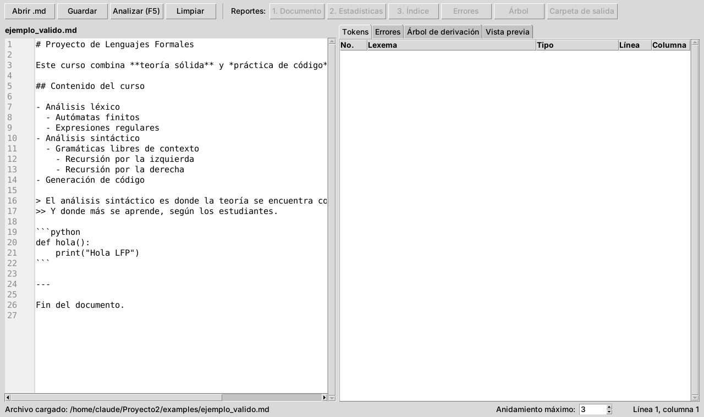

2. Haga clic en **Analizar** (o F5). En la barra de estado aparece el
   resultado, por ejemplo: *77 tokens, 0 error(es). Análisis exitoso*.
3. Revise las pestañas **Tokens**, **Errores** y **Árbol de derivación**
   (secciones 7 a 9).
4. Abra los reportes con los botones de la barra superior (sección 10).

**Corregir y volver a analizar.** El botón **Analizar** revisa lo que está
escrito en el editor, no el archivo guardado. Puede corregir un error en el
editor y presionar F5 de nuevo sin guardar. Cuando el resultado le parezca
bien, use **Guardar** para guardar los cambios en el archivo.

**Escribir un documento nuevo.** Use **Limpiar**, escriba en el editor y
presione **Analizar**. Al guardar, el programa pide el nombre del archivo.

<div class="salto"></div>

## 7. La tabla de tokens

La pestaña **Tokens** muestra cada pieza que reconoció el analizador léxico,
en el orden del archivo.

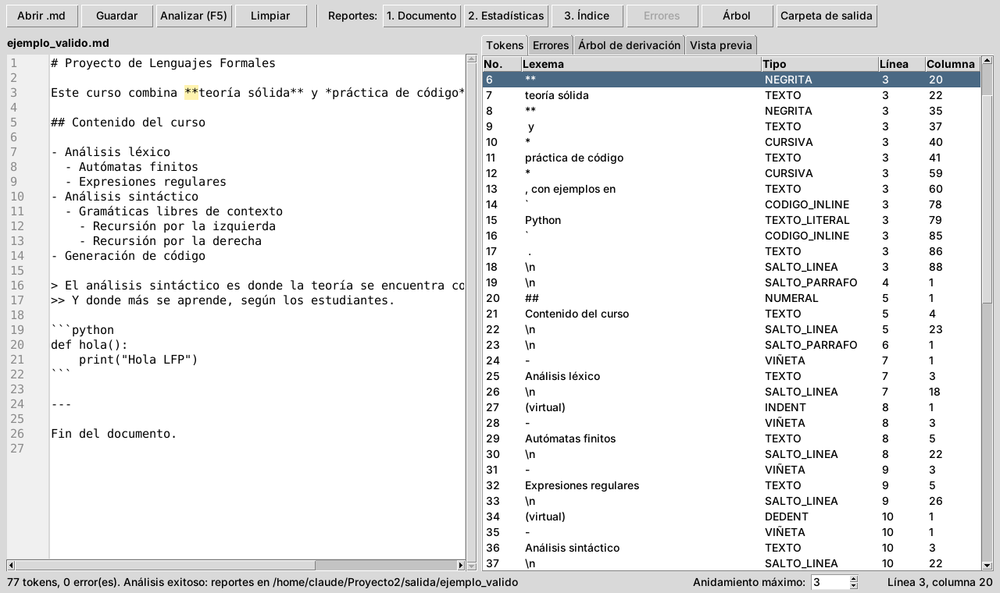

| Columna | Significado |
|---|---|
| No. | Orden del token en el archivo. |
| Lexema | El texto exacto que forma el token. `\n` es un salto de línea; *(virtual)* indica un token que no tiene texto en el archivo. |
| Tipo | La categoría del token (tabla de abajo). |
| Línea, Columna | Dónde empieza el token. La primera línea y la primera columna son la 1. |

**Haga clic en una fila** y el editor salta a ese token y lo resalta en
amarillo. En la imagen se eligió el token 6, el `**` que abre la negrita de
la línea 3.

| Tipo | Qué es |
|---|---|
| `NUMERAL` | Los `#` de un encabezado. |
| `TEXTO` | Texto normal. |
| `NEGRITA`, `CURSIVA` | Los `**` y `*` que abren o cierran el énfasis. |
| `CODIGO_INLINE` | Los acentos graves de un código en línea. |
| `TEXTO_LITERAL` | Texto que no se interpreta: el interior de un código en línea, cada línea de un bloque de código o la descripción de una imagen. |
| `VIÑETA` | El `-`, `*` o `+` de un elemento de lista. |
| `INDENT`, `DEDENT` | Tokens virtuales: la lista sube o baja un nivel. |
| `CITA` | Los `>` de una cita. Su cantidad es el nivel. |
| `CERCA_CODIGO`, `LENGUAJE_CODIGO` | Los ```` ``` ```` de un bloque de código y el lenguaje que lo acompaña. |
| `REGLA_HORIZONTAL` | Los `---` de una regla. |
| `SALTO_LINEA` | El final de una línea con contenido. |
| `SALTO_PARRAFO` | Una línea en blanco. |
| `FIN` | El final del archivo. |
| `NUMERO_LISTA`, `CASILLA` | El `1.` de una lista numerada y el `[ ]` o `[x]` de una tarea. |
| `TACHADO` | Los `~~` que abren o cierran un tachado. |
| `CORCHETE_ABRE`, `IMAGEN_ABRE`, `CORCHETE_CIERRA` | El `[` de un enlace, el `![` de una imagen y el `]` que los cierra. |
| `PARENTESIS_ABRE`, `URL`, `PARENTESIS_CIERRA` | La dirección de un enlace o una imagen, con sus paréntesis. |
| `BARRA`, `SEPARADOR_TABLA` | Cada barra vertical de una fila de tabla, y la fila separadora completa. |

## 8. El árbol de derivación

La pestaña **Árbol de derivación** muestra cómo el analizador sintáctico
organizó los tokens según la gramática del lenguaje.

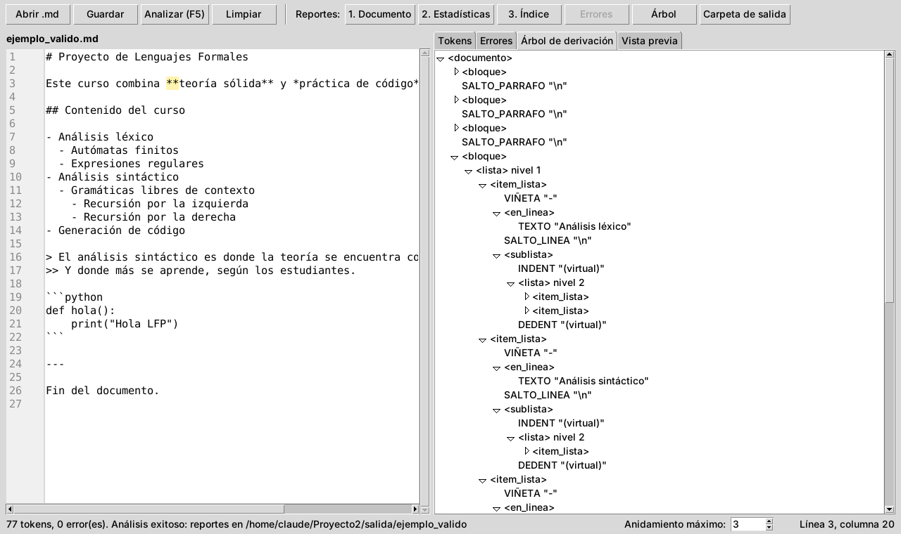

- Los nombres entre `< >`, como `<lista>` o `<encabezado>`, son las partes de
  la gramática. Los demás son tokens, con su lexema entre comillas.
- Haga clic en el triángulo de un nodo para abrirlo o cerrarlo. Al analizar,
  los primeros niveles quedan abiertos.
- Las listas y las citas indican su **nivel**: en la imagen, la lista
  `nivel 2` está dentro de un elemento de la lista `nivel 1`.

El mismo árbol también se guarda como imagen (sección 10.5).

<div class="salto"></div>

## 9. Errores: cómo leerlos y corregirlos

Si el documento tiene errores, al analizar se abre la pestaña **Errores**.
El análisis no se detiene en el primer error: los muestra todos, ordenados
por posición.

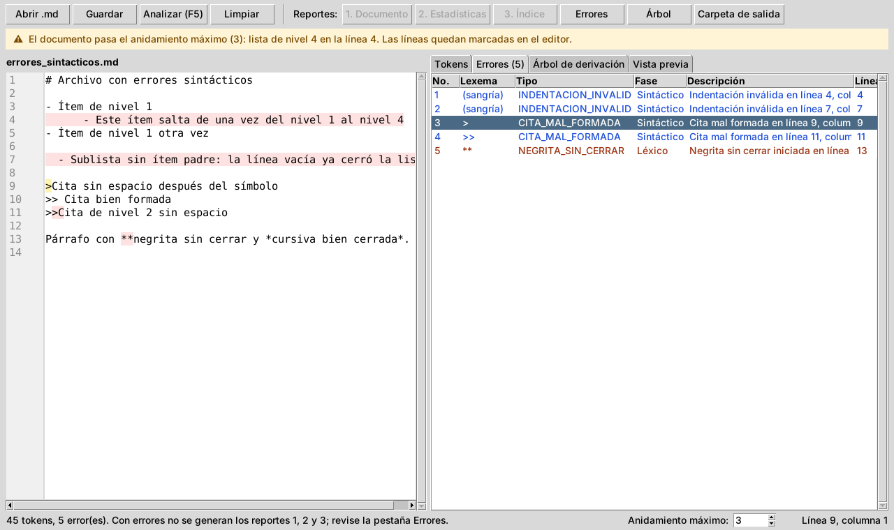

| Columna | Significado |
|---|---|
| No. | Número del error. |
| Lexema | El texto que causó el error. *(sangría)* indica un problema con los espacios del inicio de la línea. |
| Tipo | La categoría del error (tabla de abajo). |
| Fase | **Léxico** (en rojo oscuro): un problema con las piezas del texto. **Sintáctico** (en azul): las piezas están bien, pero en un orden que no es válido. |
| Descripción | El mensaje, con la línea y la columna donde empieza el problema. |
| Línea, Columna | La posición del error. |

**Haga clic en un error** y el editor salta a esa posición y la resalta. Los
errores también quedan marcados en rojo en el editor. Con errores, los
reportes 1, 2 y 3 no se generan: corrija los errores y vuelva a presionar
**Analizar**.

| Tipo de error | Fase | Causa | Cómo corregirlo |
|---|---|---|---|
| `NEGRITA_SIN_CERRAR` | Léxico | Se abrió `**` y el bloque (el párrafo, el ítem, el encabezado o la línea de cita) terminó sin cerrarlo. | Agregue el `**` de cierre antes de que termine el bloque. |
| `CURSIVA_SIN_CERRAR` | Léxico | Se abrió `*` y el bloque terminó sin cerrarlo. | Agregue el `*` de cierre, o ponga el asterisco dentro de código en línea si era un asterisco literal. |
| `CODIGO_INLINE_SIN_CERRAR` | Léxico | Un acento grave sin su pareja en el mismo bloque. | Agregue el acento grave de cierre. |
| `BLOQUE_CODIGO_SIN_CERRAR` | Léxico | El archivo terminó dentro de un bloque de código. | Agregue una línea con ```` ``` ```` al final del código. |
| `ENCABEZADO_INVALIDO` | Léxico | Más de 6 `#` en un encabezado. | Use de 1 a 6 `#`. |
| `INDENTACION_INVALIDA` | Léxico | La sangría de un elemento de lista no es múltiplo de 2 (por ejemplo, 3 espacios). | Use 2, 4, 6… espacios. |
| `INDENTACION_INVALIDA` | Sintáctico | La sangría sube más de un nivel de una vez (de 0 a 4 espacios), o una sublista no tiene elemento padre (por ejemplo, después de una línea en blanco). | Suba de 2 en 2 espacios, y no deje líneas en blanco dentro de una lista. |
| `CITA_MAL_FORMADA` | Sintáctico | Falta el espacio después del último `>`. | Escriba `> texto` o `>> texto`. |
| `TACHADO_SIN_CERRAR` | Léxico | Se abrió `~~` y el bloque terminó sin cerrarlo. | Agregue el `~~` de cierre. |
| `TABLA_MAL_FORMADA` | Sintáctico | A la tabla le falta la fila de títulos o la fila separadora (la de guiones), la separadora se repite, o una fila no termina con barra vertical o no tiene tantas celdas como la de títulos. | Revise la fila que indica el mensaje. |

### El reporte de errores

El botón **Errores** abre la misma tabla como página HTML, útil para
imprimirla o compartirla.

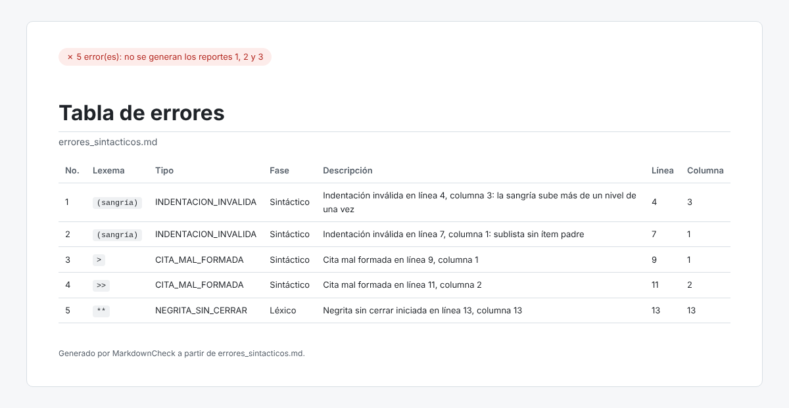

## 10. Los reportes HTML

Cada análisis guarda sus archivos en la carpeta `salida`, en una subcarpeta
con el nombre del archivo analizado. Por ejemplo, al analizar
`ejemplo_valido.md` se crea `salida/ejemplo_valido/`. El botón
**Carpeta de salida** abre esa carpeta. Cada análisis borra primero los
reportes del análisis anterior del mismo archivo, así la carpeta solo tiene
los del último.

| Archivo | Cuándo se genera | Botón |
|---|---|---|
| `reporte1_documento.html` | Sin errores | 1. Documento |
| `reporte2_estadisticas.html` | Sin errores | 2. Estadísticas |
| `reporte3_indice.html` | Sin errores | 3. Índice |
| `reporte_errores.html` | Con errores | Errores |
| `arbol.dot` y `arbol.png` | Siempre (`arbol.png` solo si Graphviz está instalado) | Árbol |

Los reportes son páginas independientes: se pueden copiar a otra
computadora y abrir con doble clic, sin MarkdownCheck.

### 10.1 Reporte 1: Documento

Es el documento convertido a HTML: los encabezados son títulos, las listas y
las citas conservan su anidamiento, y el código se muestra tal como está
escrito. Si el bloque de código dice su lenguaje (```` ```python ````), sus
palabras clave, textos y comentarios se colorean; el reporte trae lo
necesario para hacerlo, así que funciona sin internet. La etiqueta verde de
arriba confirma que el análisis no tuvo errores.

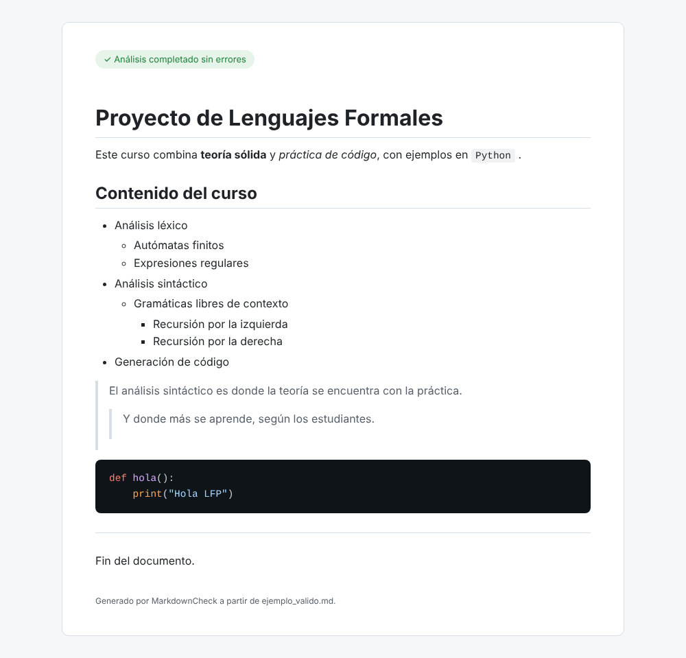

Así se ve el caso 14, que usa el alcance opcional: el tachado, el enlace, la
lista numerada con tareas, la tabla con sus alineaciones y una imagen.

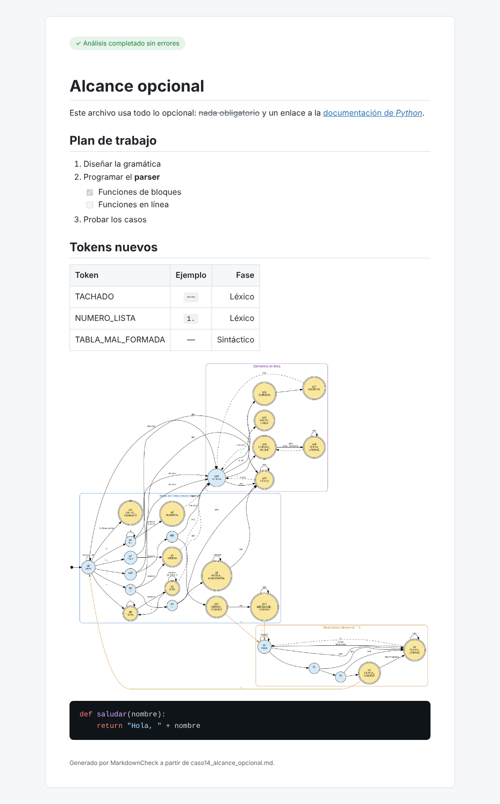

### 10.2 Reporte 2: Estadísticas

Un resumen en números del documento:

- **Tarjetas superiores:** total de palabras, párrafos, encabezados, listas,
  ítems de lista, citas, líneas de cita y bloques de código.
- **Encabezados por nivel:** una barra por cada nivel, de H1 a H6. La más
  larga corresponde al nivel con más encabezados.
- **Profundidad máxima de anidamiento:** cuántos niveles alcanzan la lista
  y la cita más anidadas.
- **Elementos en línea y separadores:** cuántos tramos hay de negrita,
  cursiva y código en línea, y cuántas reglas horizontales.
- **Alcance opcional:** solo aparece si el documento los usa. Cuenta las
  listas numeradas, las tareas (y cuántas están hechas), los tachados, los
  enlaces, las imágenes y las tablas.

Las palabras de los bloques de código y las descripciones de las imágenes no
se cuentan.

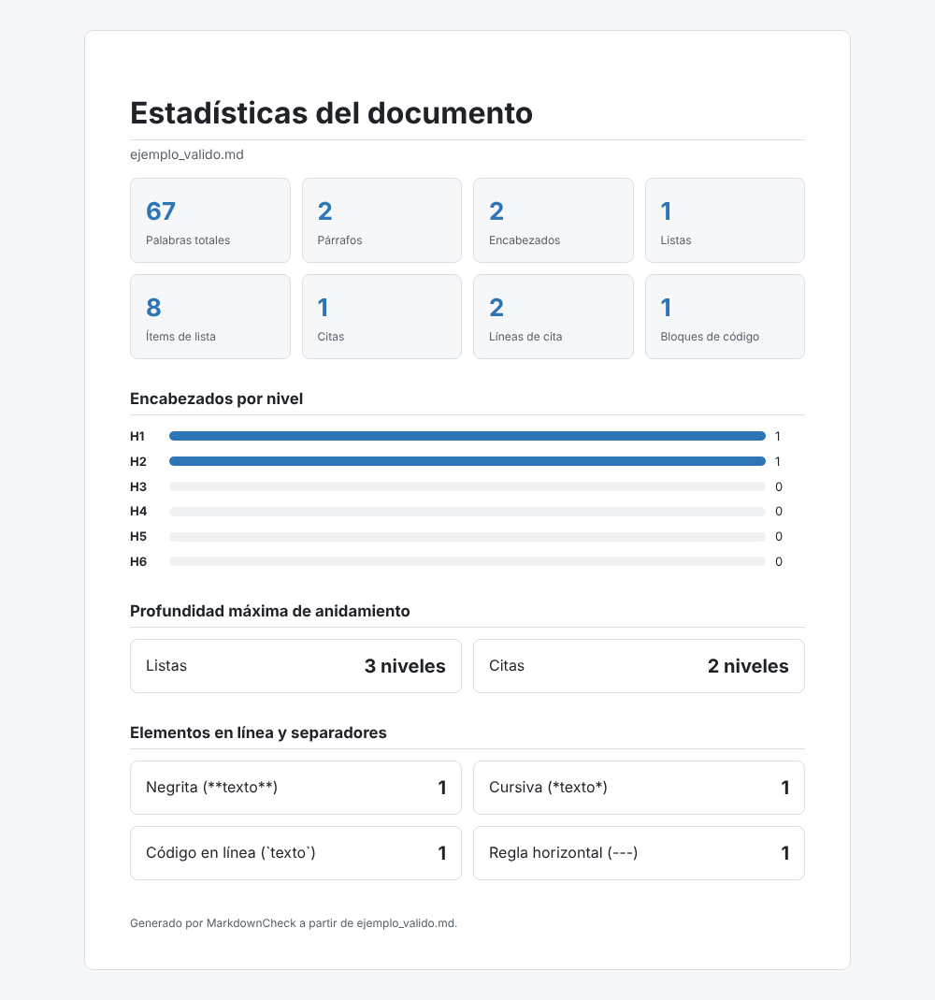

### 10.3 Reporte 3: Índice

La tabla de contenido del documento, armada con sus encabezados. Cada
entrada indica su nivel (H1, H2…) y tiene más sangría cuanto más profundo es
el nivel.

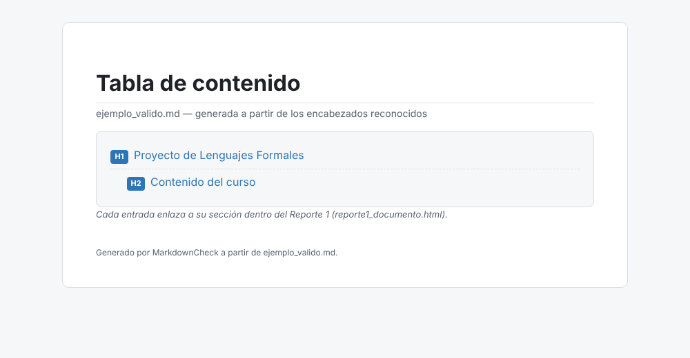

**Navegar.** Haga clic en una entrada y se abre el Reporte 1 justo en esa
sección. Por ejemplo, al hacer clic en *Contenido del curso*:

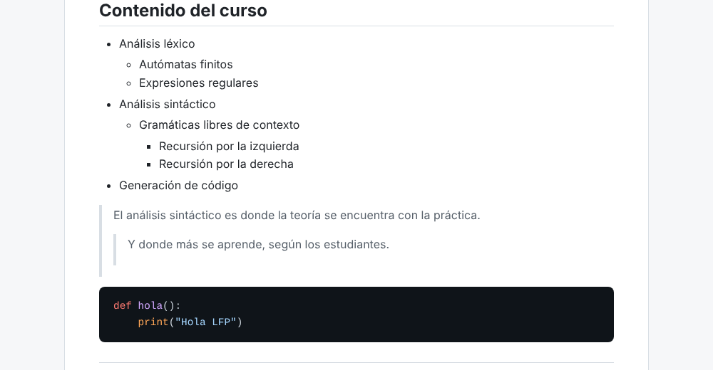

Para que los enlaces funcionen, los dos reportes deben estar en la misma
carpeta, como los deja el programa. Si el documento no tiene encabezados,
el reporte lo indica en lugar de mostrarse vacío.

### 10.4 Reporte de errores

Se describe en la sección 9.

### 10.5 Árbol de derivación como imagen

El botón **Árbol** abre `arbol.png`, el árbol de derivación completo:
la raíz `<documento>` en azul oscuro, las partes de la gramática en azul
claro y los tokens en amarillo. Si Graphviz no está instalado, el botón
avisa y abre la carpeta donde quedó `arbol.dot`, que se puede convertir en
imagen después con:

```
dot -Tpng arbol.dot -o arbol.png
```

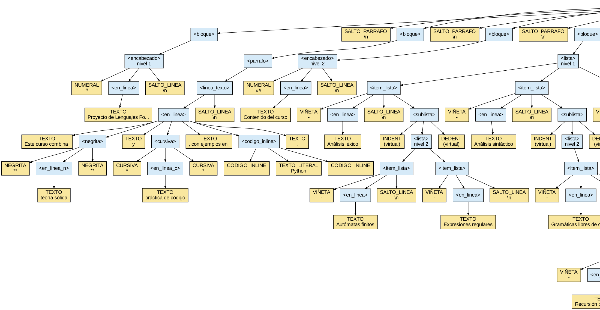

<div class="salto"></div>

## 11. Vista previa en vivo y advertencia de anidamiento

### 11.1 Vista previa

La pestaña **Vista previa** muestra el documento ya formateado, dentro de la
misma ventana: títulos grandes, negrita, cursiva, tachado, listas con su
viñeta o su número, casillas de las tareas, citas con su barra, tablas en
columnas y el código sobre fondo oscuro.

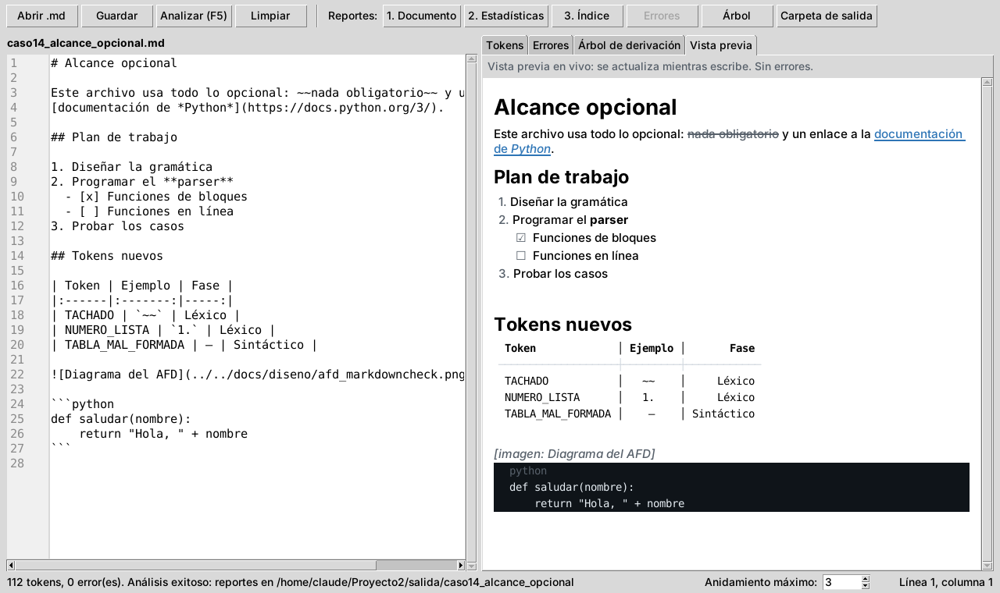

- **Se actualiza sola mientras escribe**, un instante después de dejar de
  teclear. No hace falta presionar Analizar.
- **Los enlaces se abren con un clic** en el navegador.
- Las imágenes se indican con su descripción, por ejemplo
  *[imagen: Diagrama del AFD]*; en el Reporte 1 sí se ven.
- Si el texto tiene errores, la vista previa muestra lo que se pudo
  reconocer y lo avisa arriba. Las tablas y los reportes no cambian hasta que
  se presione **Analizar**.

### 11.2 Advertencia de anidamiento

En la barra inferior, **Anidamiento máximo** indica cuántos niveles de
lista o de cita se permiten (empieza en 3). Si el documento pasa ese
número, aparece una franja amarilla arriba del editor con el nivel más
profundo y su línea, y las líneas demasiado anidadas se marcan en amarillo.

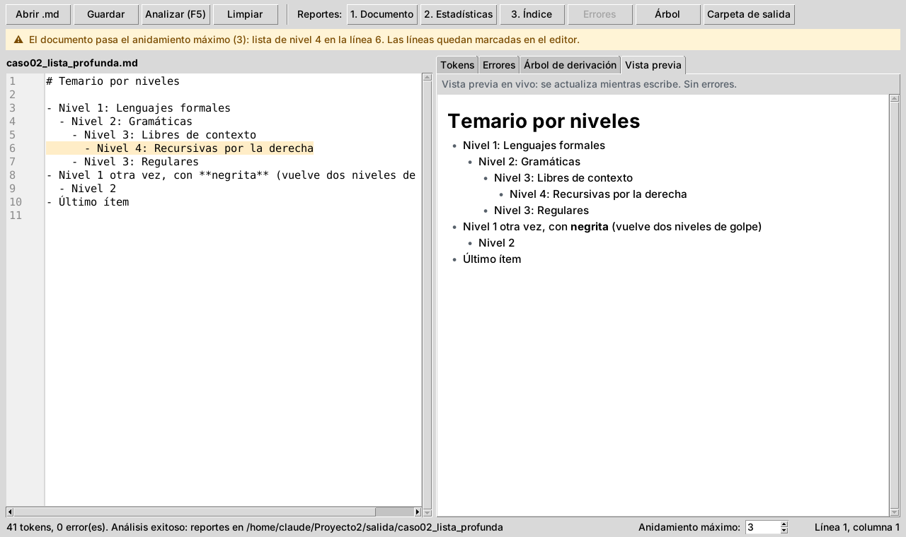

La advertencia no es un error: el documento se analiza igual y los reportes
se generan. Cambie el número con las flechas o escribiéndolo, y la franja se
actualiza al momento; también cambia mientras escribe en el editor.

<div class="salto"></div>

## 12. Solución de problemas

| Problema | Causa probable | Solución |
|---|---|---|
| `python` no se reconoce como comando | Python no está instalado o no está en el PATH. | Instale Python y marque **Add Python to PATH**, o pruebe con `py src/main.py`. |
| `No module named 'tkinter'` | En Linux, Tkinter se instala aparte. | `sudo apt install python3-tk`. En Windows viene incluido. |
| *Solo se pueden analizar archivos Markdown con extensión .md* | Se eligió un archivo con otra extensión (`.txt`, por ejemplo). | Cambie la extensión del archivo a `.md`, o copie su contenido en el editor y presione **Analizar**. |
| *El archivo no está en UTF-8* | El archivo se guardó con otra codificación. | Ábralo en VS Code y use **Guardar con codificación** → UTF-8. |
| Los botones de los reportes están grises | Todavía no se analizó, o el análisis tuvo errores. | Presione **Analizar**; si hay errores, corríjalos. |
| El botón Árbol no abre una imagen | Graphviz no está instalado. | Instálelo (sección 2) o convierta `arbol.dot` con el comando de la sección 10.5. |
| Un `*` produce `CURSIVA_SIN_CERRAR` | Un asterisco suelto siempre abre cursiva. | Escríbalo como código en línea: `` `*` ``. |
| Una sublista da `INDENTACION_INVALIDA` | La sangría no es de 2 en 2, o hay una línea en blanco antes de la sublista. | Revise los espacios y quite la línea en blanco. |
| Un enlace se ve con sus corchetes, como texto | La dirección tiene espacios, falta el `)` o hay otro `[` adentro del texto. | Escriba `[texto](direccion)` completo en una línea. |
| Una imagen no se ve en el Reporte 1 | La ruta no existe desde la carpeta del reporte. | Use una ruta relativa a `salida/<nombre>/` o una dirección `https://…`. |
| El código del Reporte 1 no sale coloreado | El bloque no dice su lenguaje. | Escriba el lenguaje después de las tres comillas: ```` ```python ````. |
| Aparece la franja amarilla de anidamiento | Una lista o una cita pasa el máximo de la barra inferior. | Suba el máximo o reduzca la sangría; no es un error. |
