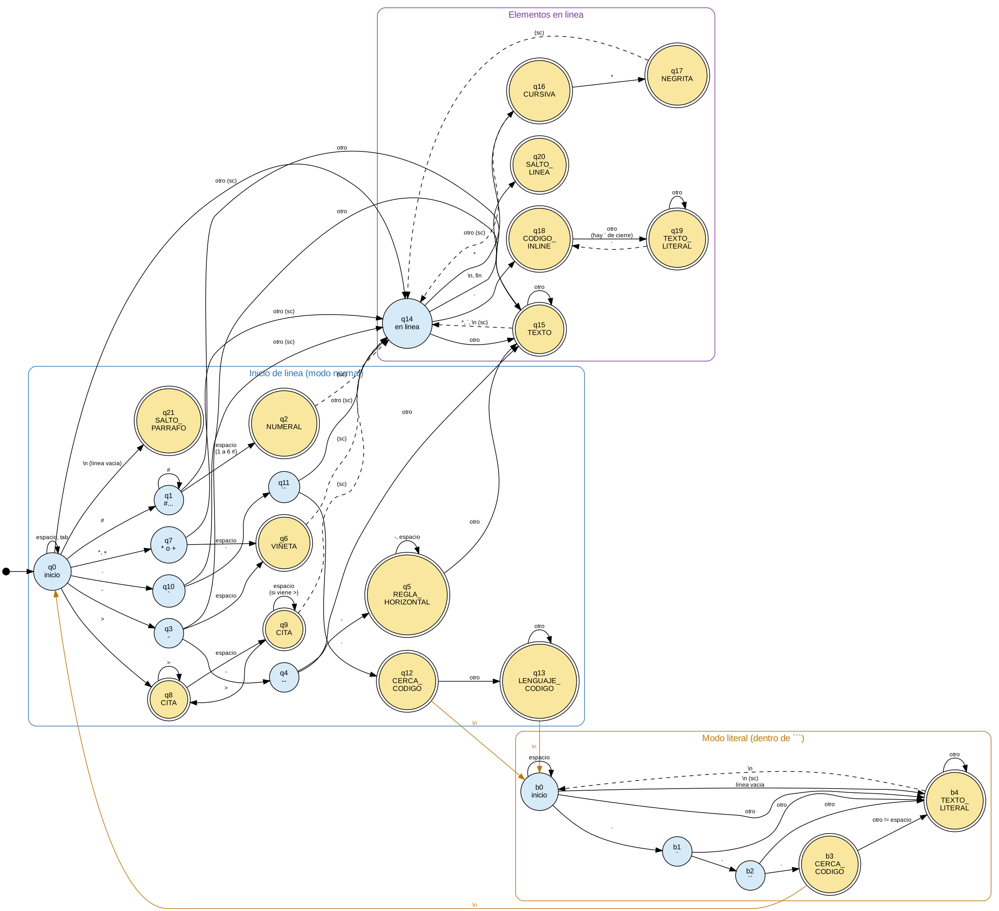

# Alcance opcional

Este archivo usa todo lo opcional: ~~nada obligatorio~~ y un enlace a la
[documentación de *Python*](https://docs.python.org/3/).

## Plan de trabajo

1. Diseñar la gramática
2. Programar el **parser**
  - [x] Funciones de bloques
  - [ ] Funciones en línea
3. Probar los casos

## Tokens nuevos

| Token | Ejemplo | Fase |
|:------|:-------:|-----:|
| TACHADO | `~~` | Léxico |
| NUMERO_LISTA | `1.` | Léxico |
| TABLA_MAL_FORMADA | — | Sintáctico |



```python
def saludar(nombre):
    return "Hola, " + nombre
```
